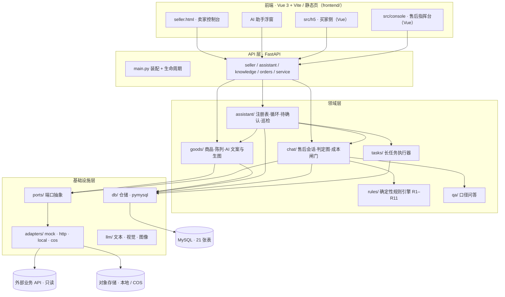
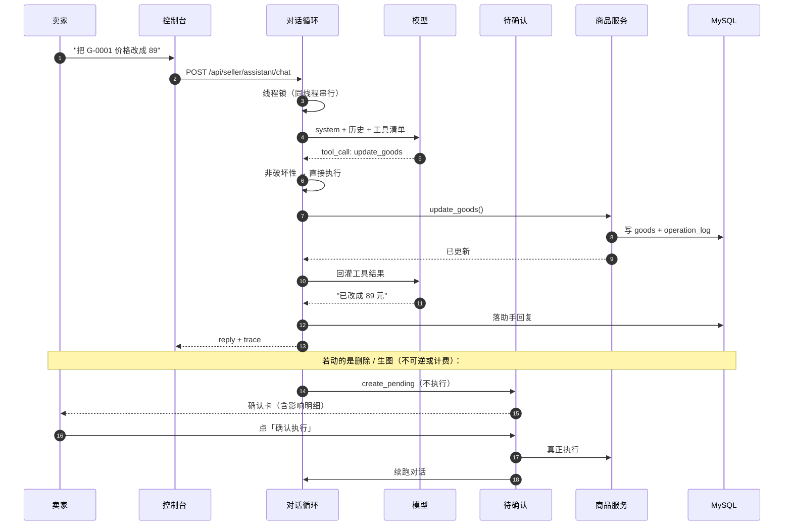
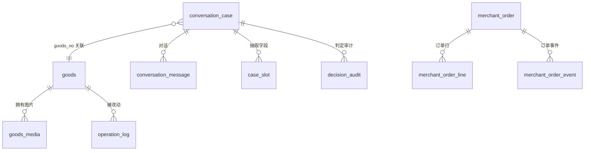

# Shop-Agent（商铺经营Agent）

> 面向**卖家**的经营控制台：**商品陈列 / 商品管理 / 售后**三个业务模块并列，
> 卖家既可**手动完成全部操作**，也可**只对 AI 助手说一句话**让它调用工具代做；
> **不可逆与计费动作必须经人确认**。

[](https://www.python.org/)
[](https://fastapi.tiangolo.com/)
[](https://langchain-ai.github.io/langgraph/)
[](https://www.mysql.com/)

---

## 目录

- [项目简介](#项目简介)
- [核心特性](#核心特性)
- [系统架构](#系统架构)
- [技术栈](#技术栈)
- [目录结构](#目录结构)
- [快速开始](#快速开始)
- [功能模块](#功能模块)
- [AI 助手设计](#ai-助手设计)
- [API 概览](#api-概览)
- [数据模型](#数据模型)
- [测试](#测试)
- [售后演示订单](#售后演示订单)
- [安全与合规边界](#安全与合规边界)
- [已知缺口](#已知缺口)
- [设计文档索引](#设计文档索引)

---

## 项目简介

**Shop-Agent**（中文名「商铺经营Agent」，仓库目录 `Shop-Agent/`）是一个单体应用：FastAPI 后端 +
Vue 3（h5 / console，经 Vite 构建）与原生静态页（seller）混合前端。
它把卖家日常经营中最高频的三件事放进同一个控制台：

| 模块 | 做什么 | 数据视角 |
| --- | --- | --- |
| **商品陈列** | 展示已上架商品的对外样貌：宣传图、文案、价格 | 上架商品的展示视图 |
| **商品管理** | 对全部商品做增删改查、上下架、排序、批量操作、回收站 | 全量商品的操作视图 |
| **售后** | 售后工单收件箱 → 接管 / 退回 / 判定 / 人工处置 / 结案 | 售后事件（工单） |
| **知识库**（支撑） | 卖家上传店规原文（政策、平台规则、商品资料），供助手检索并引用出处 | 卖家自有文档 |

**关键设计推论**：商品陈列与商品管理是**同一份商品数据的两个视图**，不是两套数据。
管理中删除 / 下架 → 陈列同步消失；陈列中改价 / 改文案 → 管理同步可见。
因此实现上**只有一张商品主表**，避免"两处真相"。

项目验收口径为四条可跑通的链路（手动链路、AI 代做链路、
售后不受影响、知识库引用与删除后如实回答），**不使用"效率提升百分比"作为验收标准**。

---

## 核心特性

| 能力 | 说明 |
| --- | --- |
| **手动 + AI 双通道** | 每个业务动作都有对应的界面操作与自然语言入口，两者调用同一套服务 |
| **人在环（Human-in-the-loop）** | 删除、下架、资金处置、AI 生图等动作先落成**待确认卡**，卖家点头前**根本不执行** |
| **确定性判定** | 退款结论由 YAML 规则引擎（R1–R11）给出，**模型不参与判定**，只负责理解与转达 |
| **工具注册表** | 加能力 = 加一个 `ToolSpec`，不改对话循环、不改 API；共 **34 个 AI 工具**、7 个域 |
| **可插拔适配层** | 业务只依赖 `app/ports/`；本地夹具 / 真实 HTTP API / 本地存储 / COS 可切换 |
| **知识库 RAG** | 上传 → 解析（含扫描件 OCR）→ 分块 → 向量化入 Chroma → 按原文问答并标注出处 |
| **成本闸门** | 免费额度（按模型）→ 月度预警 → 月度硬上限，三级兜底；成本是配置项，不是设计前提 |
| **卖家登录与数据隔离** | `seller_account` / `seller_session` + `X-Seller-Token`，所有卖家数据按 `seller_id` 隔离 |
| **订单快照与客服** | 本地导入中文订单 CSV、订单行与事件；买家咨询与卖家客服回复（本地演示） |
| **任务中心** | AI 生图 / 批量操作等长任务异步执行，支持进度、失败重试（白名单 kind） |

---

## 系统架构

### 分层架构



### 分层铁律

业务代码**只准** `from app.ports import ...`，**禁止** `import app.adapters.*`。
一旦被直接引用，"可插拔"即失效 —— 换实现就得改业务代码。

### 一条指令的端到端链路



---

## 技术栈

| 层次 | 选型 | 说明 |
| --- | --- | --- |
| 语言 | Python 3.11.15 | 本项目实测环境为 conda env `pythonproject` |
| Web 框架 | FastAPI + uvicorn | 异步 API、自动 OpenAPI |
| 编排 | LangGraph 1.2 / LangChain 1.3 | 售后判定图、agentic 工具循环 |
| 模型 | DashScope（通义千问） | 文本 `qwen3.7-max`（**纯文本**）、视觉 `qwen3-vl-plus`、向量 `text-embedding-v3` |
| 向量库 | ChromaDB ≥ 0.6（实测 1.5.9） | 本地持久化，无需额外服务 |
| 数据库 | MySQL 8.x + PyMySQL | 同步驱动 + 线程池桥接 |
| 配置 | pydantic-settings + `.env` | 系统环境变量优先于 `.env` |
| 前端 | Vue 3 + Vite（h5 / console）· 原生 HTML/CSS/JS（seller） | h5 与 console 为 SFC 多页应用；seller 仍免构建 |
| 前端构建 | Vite 6 + `@vitejs/plugin-vue` | `npm run build` 输出 `frontend/dist/` |

> **文本模型必须选纯文本型号**。LangChain 的 `ChatTongyi` 只按模型名是否含 `vl` 推断端点，
> 名字不含 `vl` 的多模态模型（如 `qwen3.7-plus` / `qwen3.8-max`）会被误判到纯文本端点，
> 稳定返回 `400 InvalidParameter: url error`。启动期 `config_validation` 会对这类型号点名告警。

---

## 目录结构

```text
Shop-Agent/
├── backend/
│   ├── run.py                     # 启动入口（uvicorn，127.0.0.1:8000）
│   ├── requirements.txt           # 依赖清单（版本经兼容性验证）
│   ├── app/
│   │   ├── main.py                # FastAPI 装配、生命周期、静态前端挂载
│   │   ├── config.py              # 配置中心
│   │   ├── config_validation.py   # 启动期配置自检
│   │   ├── models.py              # 领域模型
│   │   ├── console.py             # 售后指挥台服务
│   │   ├── ports/                 # 端口抽象（业务唯一允许依赖的外部接口）
│   │   ├── adapters/              # 端口实现（业务禁止直接 import）
│   │   ├── db/                    # 仓储层（SQL 只在这里出现）
│   │   ├── goods/                 # 商品域：CRUD、AI 文案、生图、售后统计
│   │   ├── assistant/             # AI 助手核心：注册表、循环、待确认、巡检、工具
│   │   ├── chat/                  # 售后会话、判定图、成本闸门、工具分发
│   │   ├── graph/                 # LangGraph 判定图
│   │   ├── rules/                 # 确定性规则引擎（R1–R11）
│   │   ├── qa/                    # 口径问答
│   │   ├── tasks/                 # 长任务执行器
│   │   ├── llm/                   # 文本 / 视觉 / 图像客户端
│   │   ├── tools/                 # 售后只读工具（订单/物流/画像/工单）
│   │   ├── seller/                # 卖家登录、身份依赖、控制台端点
│   │   ├── orders/                # 本地订单快照：导入、查询、行与事件
│   │   └── service_chat/          # 买家咨询与卖家客服
│   ├── scripts/
│   │   └── create_seller_account.py
│   └── tests/                     # 36 个离线测试
├── frontend/                      # 前端（后端挂载到 /ui）
│   ├── seller.html / .css / .js   # 卖家控制台 + AI 浮窗（免构建，保持原生）
│   ├── h5.html                    # 买家侧入口（Vite 入口）
│   ├── console.html               # 售后指挥台入口（Vite 入口）
│   ├── package.json / vite.config.js
│   ├── src/
│   │   ├── shared/                # 统一 API 出口、SSE 解析
│   │   ├── h5/                    # 买家侧 Vue 应用（App.vue）
│   │   └── console/               # 售后指挥台 Vue 应用（App.vue）
│   ├── legacy/                    # Vue 迁移前的原生实现（回归基线）
│   ├── dist/                      # 构建产物（不入库）
│   ├── h5.css / console.css       # 由 Vue 组件直接复用
│   └── verify_*.cjs               # 前端离线验证脚本
├── config/
│   ├── refund_rules.yaml          # 退款规则 R1–R11
│   ├── qa_knowledge.yaml          # 标准口径库
│   └── demo_orders.yaml           # 演示订单
├── sql/
│   ├── *_schema.sql               # 各域建表
│   ├── decision_audit.sql         # 判定审计表
│   └── migrations/                # 幂等迁移（只增不改）
├── docs/                          # 设计 / 契约 / 架构 / 启动指南
├── evals/                         # 评测用例与脚本
├── samples/kb_demo/               # 知识库演示素材（政策 md / 规则 pdf / 口径 docx）
├── _archived/                     # 历史归档（默认不入库）
├── .env.example                   # 配置模板（不含真实密钥）
└── .gitignore
```

---

## 快速开始

### 1. 前置条件

| 项 | 要求 |
| --- | --- |
| Python | 3.11.x（本项目实测 3.11.15） |
| MySQL | 8.x，需先启动并可连接；库名 `Shop-Agent`（含连字符，SQL 中须用反引号） |
| 端口 | `8000` 未被占用 |
| Node.js | 18+（实测 22.22） | **构建 h5 / console（Vue 3 + Vite）必需**；前端验证脚本也需要 |

> 对话层与商品域依赖 MySQL。**数据库不可达时建单会返回 500**，这是预期失败，不会静默降级。

### 2. 安装依赖

```bash
cd backend
python -m pip install -r requirements.txt
```

### 3. 配置环境变量

```bash
cd backend
cp .env.example .env
```

至少填写以下两项：

| 变量 | 必填 | 说明 |
| --- | --- | --- |
| `DASHSCOPE_API_KEY` | 是（用模型时） | 文本 / 视觉 / 向量化共用 |
| `MYSQL_URI` | 是 | `mysql+pymysql://<用户>:<口令>@<host>:<port>/<db>?charset=utf8mb4` |

其余开关均有可用默认值。完整说明见 `backend/.env.example` 的分节注释。

> ⚠️ `.env` 已被 `.gitignore` 排除，**不要提交真实密钥**。
> 若使用云对象存储，另需 `COS_SECRET_ID` / `COS_SECRET_KEY` / `COS_BUCKET`。

### 4. 初始化数据库

按需执行建表脚本（**不会自动执行全部迁移**）：

```bash
mysql -h <host> -P <port> -u <user> -p <db> < sql/goods_schema.sql
mysql -h <host> -P <port> -u <user> -p <db> < sql/chat_schema.sql
mysql -h <host> -P <port> -u <user> -p <db> < sql/assistant_schema.sql
mysql -h <host> -P <port> -u <user> -p <db> < sql/task_schema.sql
mysql -h <host> -P <port> -u <user> -p <db> < sql/decision_audit.sql
mysql -h <host> -P <port> -u <user> -p <db> < sql/seller_schema.sql
mysql -h <host> -P <port> -u <user> -p <db> < sql/order_schema.sql
mysql -h <host> -P <port> -u <user> -p <db> < sql/service_schema.sql
```

说明：

- `seller_schema.sql` 相关的登录表在后端启动时也会自动建表，可不必手动执行。
- **订单与客服模块**使用前必须先执行 `order_schema.sql` 与 `service_schema.sql`；
  未迁移时相关接口返回 `503`。
- `sql/migrations/` 为幂等增量迁移，只增不改，可重复执行。
- `sql/apply_*.py` 迁移工具**默认仅预览**，显式传 `--apply` 才会连接数据库并写入。
  执行前请确认目标库与备份。

### 5. 启动后端

```bash
cd backend
python run.py
```

等价命令：

```bash
python -m uvicorn app.main:app --host 127.0.0.1 --port 8000
```

> **不要直接运行 `app/main.py`**。它使用包内导入且没有启动入口块，直接运行会报
> `ModuleNotFoundError: No module named 'app'`。服务必须由 ASGI 服务器加载。
>
> 后端 `reload=False`，**改代码后必须重启进程**。

### 6. 构建前端（Vue 页面）

h5 与 console 已迁移为 Vue 3 + Vite 多页应用，需先安装依赖并构建：

```bash
cd frontend
npm install
npm run build
```

产物输出到 `frontend/dist/`，由后端 `/ui/dist/` 直接托管。

- 开发调试：`npm run dev`（默认 5173，`/api` 代理到 8000），改完仍需 `npm run build` 供后端访问。
- **h5 / console 的构建产物是 ES Module，不能再通过 `file://` 双击打开**；请经后端 `/ui` 或静态服务器访问。
- `seller.html` 仍是免构建静态页，但其内嵌的售后指挥台指向 `dist/console.html`，因此**仍需先构建**。

### 7. 打开前端

| 页面 | 源文件 | 访问地址 | 用途 |
| --- | --- | --- | --- |
| 卖家控制台 | `frontend/seller.html` | `http://127.0.0.1:8000/ui/seller.html` | 商品 / 陈列 / 售后 / 知识库 + AI 助手 |
| 售后指挥台 | `frontend/console.html` | `http://127.0.0.1:8000/ui/dist/console.html` | 收件箱、接管、退回、结案 |
| 买家 H5 | `frontend/h5.html` | `http://127.0.0.1:8000/ui/dist/h5.html?order_id=DEMO001` | 扮演买家发起售后 |
| 引导页 | — | `http://127.0.0.1:8000/` | 列出所有入口 |
| API 文档 | — | `http://127.0.0.1:8000/docs` | Swagger UI（86 个操作） |

若后端不在 8000 端口，前端支持 `?api=http://127.0.0.1:8001` 覆盖。

### 8. 登录卖家控制台

首次启动且账号表为空时，后端按 `.env` 中以下配置创建初始账号：

```ini
SELLER_BOOTSTRAP_USERNAME=admin
SELLER_BOOTSTRAP_PASSWORD=<自行设置>
SELLER_BOOTSTRAP_NAME=默认卖家
SELLER_BOOTSTRAP_SELLER_ID=default
SELLER_SESSION_HOURS=12
```

> **上线前必须修改初始口令**。改 `.env` 对已存在账号无效（该段只在账号表为空时生效）。
> 修改已有账号密码或新建账号：

```bash
cd backend
python scripts/create_seller_account.py --username admin --password '新口令' --reset-password
python scripts/create_seller_account.py --username alice --password '强口令' \
    --display-name 爱丽丝 --seller-id shop_alice
```

新建账号会得到一间**空店**（无商品、无知识库），这是数据隔离的真实结果。

---

## 功能模块

### 商品陈列

- 展示已上架商品的宣传图、文案、价格。
- 支持手动编辑，也支持对 AI 说一句话生成文案、给出定价建议。
- AI 生成宣传图走异步任务（通义万相），生成后**立刻转存**到本地 / 对象存储
  —— 官方返回的图片 URL 约 5 分钟过期，不能直接写入商品表。

### 商品管理

- 完整 CRUD、上下架、排序、批量操作、类目聚合、回收站。
- **删除 = 软删**（进入回收站 7 天），AI 能删就必须能救。
- 每次改动写 `operation_log`，记录 `actor`（human / ai / system）、`before` / `after`、`undoable`。
- 批量操作提供前后 diff，执行结果逐项汇报（含失败与未做项）。

### 售后

- 收件箱 → 详情 → 接管 / 退回智能体 / 人工结案。
- 判定链：收件 → 取数 → 举证 → 规则判定 → 处置 → 审计。
- **模型不参与判定**：结论由 `config/refund_rules.yaml` 的 R1–R11 给出，逐条输出依据。
- 资金动作走**双闸门**（`SHADOW_MODE` + `DISPOSAL_ENABLED`），默认只记录不执行。

### 知识库

- 支持 `.md` / `.txt` / `.pdf` / `.docx` 与截图 OCR。
- 上传 → 解析 → 分块（默认 700 字 / 100 字重叠）→ 向量化 → 入 Chroma。
- 助手回答时检索并按原文引用；资料里没有就如实说没找到，**不用常识补规则**。
- 单份资料上限 10 MB，超限在解析前拒绝，不截断。
- 改向量模型或维度**必须重建库**，否则查询向量与旧向量不在同一空间。

### 订单工作台

- 导入商家导出的中文订单 CSV，映射列名、校验金额公式、计算规范化内容哈希。
- 同号同内容幂等、同号不同内容冲突；导入结果可选择并查看详情。
- 本地订单快照与外部平台订单**明确区分**，页面不声称本地写入已同步平台。
- 物流公司与运单号只证明快照中存在运单，不能推导真实揽收 / 在途 / 签收时间。

### 客服咨询

- 买家侧发起咨询，卖家侧查看并回复；会话与消息落库。
- 当前为**本地演示**，凭随机令牌访问；无身份核验时不展示订单信息，也不直接转入售后判定。
- 咨询原文可能含个人信息，当前 AI 只读取咨询状态，不读取原文、不自动发言。

---

## AI 助手设计

### 四个部件

| 部件 | 文件 | 一句话 |
| --- | --- | --- |
| **工具注册表** | `assistant/registry.py` | 加能力 = 加一个 `ToolSpec`，不改循环、不改 API |
| **对话循环** | `assistant/loop.py` | 模型自主选工具；代码只守三条边界 |
| **待确认动作** | `assistant/actions.py` | 破坏性 / 计费动作落库等卖家点头，确认前不执行 |
| **经营巡检** | `assistant/scan.py` | 跨域扫 5 类问题，**只建议不执行** |

### 工具分布（共 34 个）

| 域 | 数量 | 代表能力 |
| --- | --- | --- |
| 商品 | 15 | 查询、新建、改价、上下架、删除、批量、生成文案、定价建议 |
| 陈列 | 2 | 陈列视图、发布状态 |
| 售后 | 4 | 工单查询、进度、处置（复用指挥台） |
| 运维 | 6 | 巡检、任务进度、操作日志、撤销、重试 |
| 知识 | 3 | 检索、文档列表、删除文档（破坏性） |
| 订单 | 2 | 本地订单快照查询、订单详情（只读） |
| 客服 | 2 | 咨询列表、快捷回复查询（只读） |

> 合计 **34 个工具 / 7 个域**。工具数由 `test_tool_coverage.py` 与端点自动比对，
> 防止"能力写好了但漏接注册表"。

### 代码守的三条边界

1. **未知工具拒绝**：模型只能调用注册表中存在的工具。
2. **需确认转卡**：`destructive` 或 `billable` 的工具不直接执行，转为待确认动作。
3. **步数收口**：单轮有工具调用上限，防止模型空转。

### 其他可靠性约束

| 约束 | 实现 |
| --- | --- |
| 同线程串行 | 线程锁，避免续跑与新消息互相污染 |
| 幂等 | 按"核心对象"生成幂等键，避免重复确认卡 |
| 只读失败重试 | 只读工具失败自动重试一次；写操作失败**升级人工**，绝不当成功 |
| 成本闸门 | 免费额度（按当前模型）→ 月度预警 → 月度硬上限 |
| 对话历史 | 取**最近 N 条**，从卖家发言起，避免模型答上一句 |
| 状态陈述 | "已发起 / 生成中 / 马上接着"三类说法各有事实源，不凭模型自觉 |

---

## API 概览

共 **86 个 OpenAPI 操作**，完整定义以 `/docs` 为准。

| 前缀 | 说明 | 鉴权 |
| --- | --- | --- |
| `/api/seller/auth` | 登录、登出、当前身份 | 登录接口除外 |
| `/api/seller` | 商品、陈列、任务、日志、回收站、概览 | `X-Seller-Token` |
| `/api/seller/assistant` | 助手对话、消息、待确认动作、巡检 | `X-Seller-Token` |
| `/api/seller/knowledge` | 知识库上传、检索、文档列表、删除 | `X-Seller-Token` |
| `/api/seller/orders` | 本地订单导入、列表、详情 | `X-Seller-Token` |
| `/api/seller/service` | 卖家侧客服会话与回复 | `X-Seller-Token` |
| `/api/service` | 买家侧咨询（本地演示，随机令牌） | 咨询令牌 |
| `/api/console` | 售后指挥台：收件箱、详情、接管、退回、结案 | — |
| `/api/h5` | 买家侧售后受理 | — |
| `/api/health` | 健康检查（含成本闸门状态） | — |

**为什么用 `X-Seller-Token` 而不是 Cookie**：前端常以 `file://` 或独立静态端口打开，
与后端不同源；Cookie 在 `CORS=*` 下无法可靠携带，因此使用显式请求头。

---

## 数据模型

当前 DDL 共 **21 张表**（以 `sql/*.sql` 实际建表语句为准）：

| 域 | 表 |
| --- | --- |
| 商品 | `goods` `goods_media` `operation_log` |
| 售后 | `conversation_case` `conversation_message` `case_slot` `decision_audit` `guardrail_event` |
| 助手 | `assistant_message` `pending_action` |
| 任务 | `ops_task` |
| 计量 | `llm_usage` |
| 登录 | `seller_account` `seller_session` |
| 订单 | `merchant_order` `merchant_order_line` `merchant_order_import_payload` `merchant_order_event` |
| 客服 | `service_conversation` `service_message` `quick_reply` |

核心关系：



---

## 测试

### 后端（离线，不发起计费调用）

```bash
cd backend
# Windows 建议先设置编码，避免含 ¥ 等字符的输出触发 GBK 错误
set PYTHONIOENCODING=utf-8
python -m pytest tests -q
```

共 36 个测试文件，覆盖规则引擎、判定图、助手循环、工具注册、知识库、登录鉴权、
订单导入、客服消息、成本闸门等。多数使用假仓储 / 假模型，无需外部服务。

### 前端（构建检查 + 离线回归）

```bash
# 构建检查：SFC 编译与多页产物
cd frontend && npm run build

# 离线回归（h5 / console 迁移后，脚本指向 frontend/legacy/ 的原生实现）
node frontend/verify_seller.cjs
node frontend/verify_console.cjs
node frontend/verify_h5.cjs
node frontend/verify_commerce.cjs
```

> `verify_h5.cjs` / `verify_console.cjs` 当前验证的是 `legacy/` 中的原生实现（行为基线）；
> Vue 组件的交互验证依赖构建 + 手工链路，组件级单测待补。

**硬规则**：

- 自动化验证**不发起计费模型调用**；需要真实模型的验证由使用者自行执行。
- 改前端语义后**必须**跑对应 `verify_*.cjs`，只跑后端不够。
- 改数据模型后**必须**跑全量（含 `test_goods_service` / `test_aftersale_stats`）。
- 涉及 MySQL 的烟测脚本需明确授权，且应先确认目标库与清理范围。

---

## 售后演示订单

`config/demo_orders.yaml` 预置 6 个订单，覆盖主要判定分支：

| 订单号 | 商品 | 金额 | 物流 | 预期结论 |
| --- | --- | --- | --- | --- |
| `DEMO001` | 蓝牙耳机 Pro 2 | ¥39 | 未签收 | 未收到货 → 退款（R2） |
| `DEMO002` | 手机壳 | ¥199 | 已签收 | 称未收到 → 补证（R3） |
| `DEMO003` | 快充数据线 2 米 | ¥30 | 已签收 | 小额高信用 → 退款（R4） |
| `DEMO004` | 收纳盒 | ¥120 | 已签收 | 高频退款 → 转人工（R5） |
| `DEMO005` | 保温杯 500ml | ¥89 | 已签收 | 错发补发 → 补发（R9） |
| `DEMO006` | 护眼台灯 | ¥1800 | 已签收 | 质量争议 → 转人工（R1+R7） |

买家界面开启「演示模式」后，任意订单号都会按订单号**确定性合成**订单 / 物流 / 画像事实，
并统一标注 `synthetic`。已配置真实 `ORDER_API_BASE` / `LOGISTICS_API_BASE` 时演示模式自动失效。

---

## 安全与合规边界

| 边界 | 现状 |
| --- | --- |
| **资金动作** | 默认 `SHADOW_MODE=true` + `DISPOSAL_ENABLED=false`，只记录不执行；两者同时放开且配置执行地址才具备资格，否则拒绝并升级人工 |
| **破坏性动作** | 删除 / 下架 / 删知识文档等必须人工确认；确认前不执行 |
| **计费动作** | 生图 / 文案 / 定价建议同样走确认卡，费用可见 |
| **数据源** | `DATA_SOURCE=remote` 时取不到数据**明确失败并记 error**，绝不静默回落夹具 |
| **个人信息** | `VISION_INCLUDE_BUYER_NOTE=false`，买家留言默认不送第三方模型；咨询原文当前不送模型 |
| **密钥** | 仅存 `.env`，已被 `.gitignore` 排除；文档与日志不回显密钥 |
| **鉴权** | 卖家接口统一 `X-Seller-Token`；会话 12 小时，退出即服务端失效；连续 5 次失败锁 10 分钟 |

> 本项目**不是生产级鉴权 / 审计合规实现**。单卖家本地形态下的缺口在文档中显式声明，
> 不假装已具备生产资质。

---

## 已知缺口

| 缺口 | 说明 |
| --- | --- |
| **SPU / SKU 模型** | 当前商品单层（一个价格一个库存），装不下真实多规格商品 |
| **真实平台 API** | 缺 OAuth 令牌管理、分页增量、限流重试、回调验签；`DataSource` 目前主要覆盖订单 |
| **主动巡检** | 当前是规则驱动（5 类写死），不是 AI 自主发现新问题类型 |
| **账号体系** | 无自助注册、找回密码、第三方登录 |
| **买家身份核验** | 咨询为本地演示，凭随机令牌访问，无实名 / 订单归属校验 |
| **多行订单售后** | 判定链仍主要按主商品，多行订单需补订单行选择与归属校验 |

---

## 设计文档索引

| 文档 | 内容 |
| --- | --- |
| `docs/定位_卖家控制台_v1.md` | **项目总定位**：做什么、为什么、验收标准 |
| `docs/项目架构_v1.md` | 活文档：分层、模块清单、关键设计决定、数据模型 |
| `docs/方案_卖家控制台_架构与实施_v1.md` | 信息架构、API、工具集、分阶段实施 |
| `docs/设计_智能体能力地图_v1.md` | 34 个工具的能力边界与域划分 |
| `docs/设计_可插拔适配层_v1.md` | 端口 / 适配器设计与切换方式 |
| `docs/契约_外部数据源_v1.md` | 外部数据源接口契约 |
| `docs/方案_订单与客服会话_v1.md` | 订单快照与客服咨询的设计与边界 |
| `docs/启动与自测指南.md` | 启动、登录、模型配置、常见问题 |
| `docs/开发记录.md` | 实施过程与踩坑记录 |

---

## 许可

本项目为个人开发项目。如需引用或二次开发，请先与作者确认。
