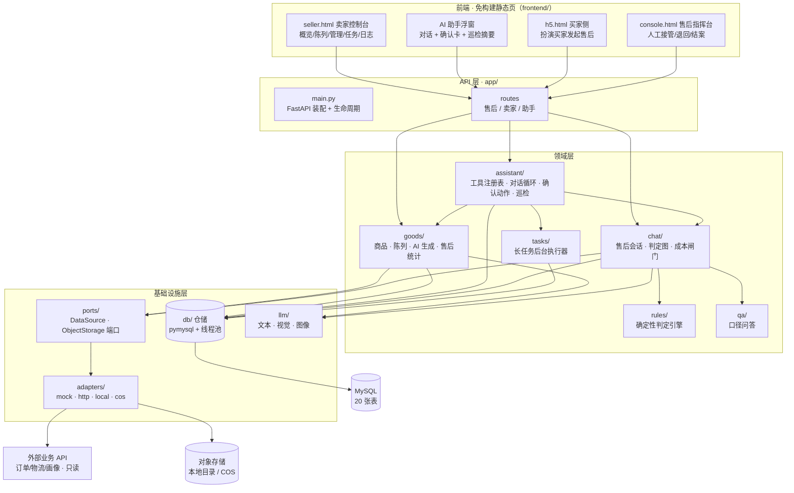
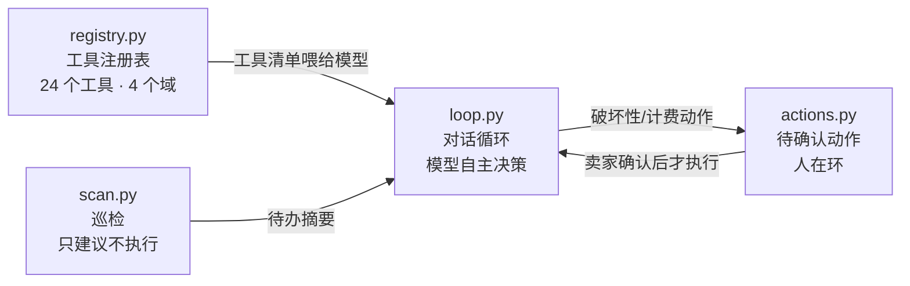
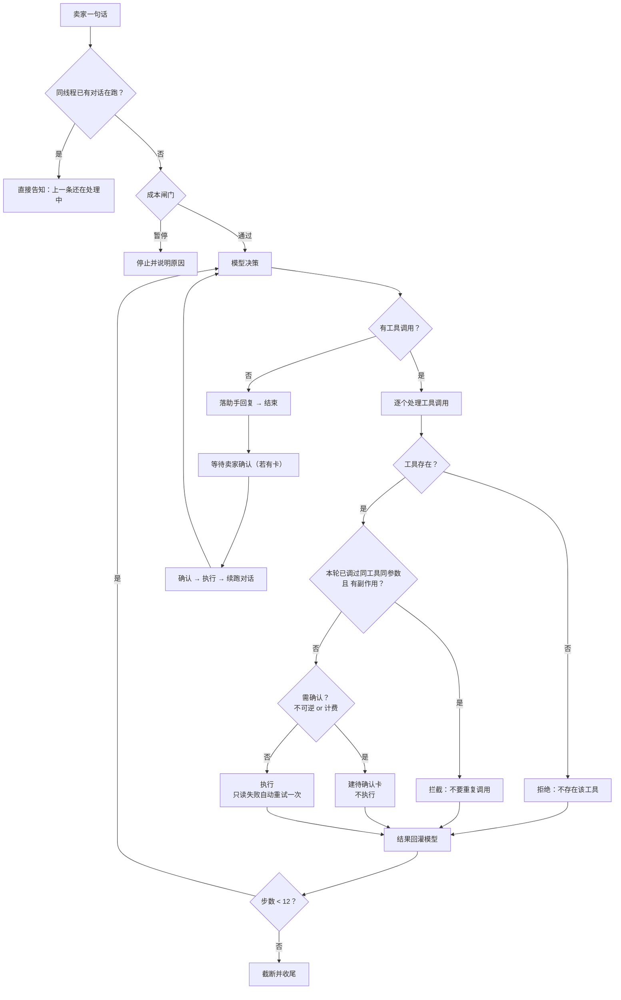
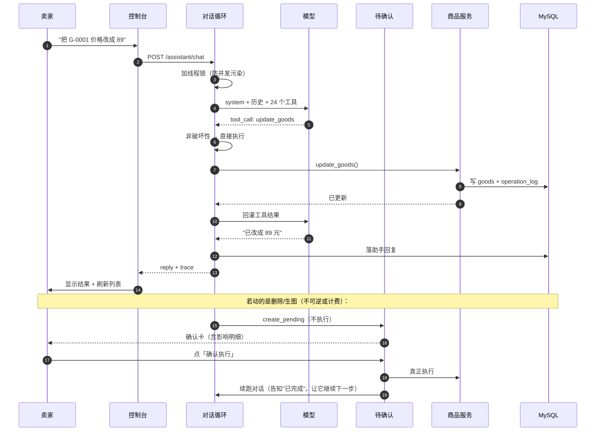
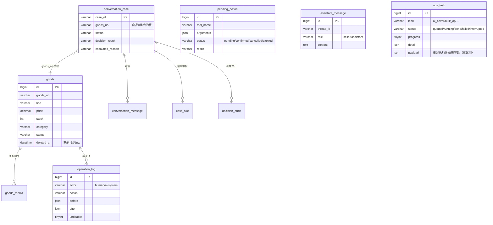

# 项目架构图 · 商铺经营Agent

> **这是活文档，随代码更新。**
>
> 以下情况必须同步改这份文档：
> - 新增 / 删除 / 重命名模块、端点、AI 工具
> - 新增数据表或字段
> - **改变关键设计决定**（尤其"人在环"边界、幂等口径、并发策略）
>
> 每次更新请在文末「变更记录」追加一行。**文档与代码不一致时，以代码为准，并立即修文档。**

当前规模：**86 个 OpenAPI 操作 · 34 个 AI 工具 · 20 张 MySQL DDL 表**（2026-10-21，按当前工作区代码核对）。

---

## 一、一句话定位

> 面向**卖家**的经营控制台：商品陈列 / 商品管理 / 售后三模块并列；
> 卖家**可手动完成全部操作**，也**可以只对 AI 说一句话**让它代做 ——
> **不可逆动作必须经人确认**。

---

## 二、分层架构



**分层铁律**：业务代码**只准** `from app.ports import ...`，**禁止** `import app.adapters.*`。
一旦被直接引用，"可插拔"就失效了 —— 换实现就得改业务代码。

---

## 三、目录结构与模块清单

### 3.1 代码地图

> 读法：**每一行 = 一个文件（或目录）+ 它负责的那一件事**。★ 标记的是本项目的核心。

```text
refund-agent/
├── backend/
│   ├── run.py                          # 启动入口：读配置并拉起 uvicorn（默认 8000）
│   ├── app/
│   │   ├── main.py                     # FastAPI 装配：lifespan 注入夹具 / 回填 / 清理
│   │   ├── config.py                   # 配置中心：.env 加载、模型/数据源/存储开关
│   │   ├── config_validation.py        # 启动期配置自检：缺项与风险项点名
│   │   ├── models.py                   # 领域模型：订单 / 物流 / 买家画像快照
│   │   ├── console.py                  # 售后指挥台服务：列表 / 详情 / 接管 / 退回 / 结案
│   │   ├── demo_seed.py                # 演示夹具注入 + 历史工单补 goods_no（幂等）
│   │   ├── dev_seed.py                 # 开发种子：订单 / 物流 / 画像写入
│   │   │
│   │   ├── ports/                      # ★ 端口层：业务唯一允许依赖的外部接口
│   │   │   ├── datasource.py           #   数据源端口（订单/物流/画像）+ **商品只读源**
│   │   │   └── storage.py              #   对象存储端口（put / get / delete）
│   │   ├── adapters/                   # ★ 端口实现（业务代码禁止直接 import）
│   │   │   ├── datasource_mock.py      #   进程内夹具（演示数据，零外部依赖）
│   │   │   ├── datasource_http.py      #   真实只读 API（**绝不回落到夹具**）
│   │   │   ├── mapping.py              #   外部 JSON → 领域模型（字段映射）
│   │   │   ├── coerce.py               #   类型容错：金额 / 时间 / 枚举
│   │   │   ├── http_client.py          #   带超时的 HTTP 客户端
│   │   │   └── storage_local.py        #   本地目录存储实现
│   │   │
│   │   ├── db/                         # 仓储层：同步 pymysql + run_sync
│   │   │   ├── connection.py           #   连接（URI 解析、超时、线程池桥接）
│   │   │   ├── goods_repo.py           #   商品 / 图片 / 操作日志 / 回收站 / 类目聚合
│   │   │   ├── assistant_repo.py       #   助手对话原文 + 待确认动作
│   │   │   ├── task_repo.py            #   任务记录（长任务 / 批量操作）
│   │   │   ├── chat_repo.py            #   售后：会话 / 消息 / 槽位 / 工单查询
│   │   │   └── audit_repo.py           #   判定审计
│   │   │
│   │   ├── goods/                      # 商品域
│   │   │   ├── service.py              #   商品 CRUD / 上下架 / 排序 / 批量 / 回收站
│   │   │   ├── ai.py                   #   AI 文案生成 + 定价建议（**代码守边界**）
│   │   │   ├── image_ai.py             #   AI 宣传图：投递任务 + **立刻转存**
│   │   │   └── aftersale_stats.py      #   商品 × 售后统计（**全程无模型参与**）
│   │   │
│   │   ├── assistant/                  # ★★ AI 助手核心
│   │   │   ├── registry.py             #   工具注册表：域 / 破坏性 / 计费 / 幂等键 / 失败策略
│   │   │   ├── loop.py                 #   对话循环：幂等拦截 · 并发锁 · 重试 · 步数收口
│   │   │   ├── actions.py              #   待确认动作（**人在环：确认前根本不执行**）
│   │   │   ├── scan.py                 #   经营巡检：5 类规则 + 规则自述
│   │   │   ├── tools_goods.py          #   商品域 14 个工具
│   │   │   ├── tools_aftersale.py      #   售后域 4 个工具（**完全复用指挥台**）
│   │   │   ├── tools_ops.py            #   运维域 4 个工具（巡检 / 任务 / 日志 / 撤销）
│   │   │   └── routes.py               #   助手端点：chat / messages / actions / issues
│   │   │
│   │   ├── chat/                       # 售后对话内核
│   │   │   ├── session.py              #   会话生命周期 + 状态迁移
│   │   │   ├── agent.py                #   agentic 循环子图（LangGraph）
│   │   │   ├── llm_adapter.py          #   模型适配（ChatModel 协议，真机与桩同接口）
│   │   │   ├── cost_gate.py            #   成本闸门：月度预算 + 单次预检 + 用量记账
│   │   │   ├── tools.py                #   工具分发（白名单二次校验）
│   │   │   ├── tool_spec.py            #   工具规格（给模型看的 6 个只读/提交工具）
│   │   │   ├── slots.py                #   三要素抽取（原因 / 对象 / 诉求）
│   │   │   ├── orchestrator.py         #   编排：跑图 + 落库
│   │   │   ├── reply.py                #   回复渲染
│   │   │   └── state.py                #   会话状态机定义
│   │   ├── graph/                      # 判定图（LangGraph）
│   │   │   ├── builder.py              #   图装配（节点 + 边）
│   │   │   ├── routing.py              #   条件路由
│   │   │   ├── queries.py              #   线程状态查询
│   │   │   └── state.py                #   图状态定义
│   │   ├── rules/                      # 确定性规则引擎（**模型不参与判定**）
│   │   │   ├── engine.py               #   规则执行 + 逐条依据
│   │   │   ├── loader.py               #   从 YAML 加载规则（加载期严格校验）
│   │   │   ├── facts.py                #   事实装配
│   │   │   └── disposal.py             #   处置：资金动作走双闸门
│   │   ├── qa/                         # 口径问答
│   │   │   ├── answering.py            #   确定性回答 + 可选模型润色
│   │   │   ├── knowledge.py            #   知识库检索
│   │   │   └── labels.py               #   字段 / 结论的中文标签
│   │   ├── tasks/                      # 长任务
│   │   │   ├── runner.py               #   后台协程执行：submit / run_inline
│   │   │   └── retry.py                #   失败重试：按 payload 重建执行体（白名单 kind）
│   │   ├── llm/                        # 模型客户端
│   │   │   ├── client.py               #   文本 + 视觉（DashScope）
│   │   │   └── image_gen.py            #   图像生成：异步任务 + 轮询 + 下载
│   │   ├── tools/                      # 售后域只读工具（模型可调）
│   │   │   ├── order.py                #   订单事实
│   │   │   ├── logistics.py            #   物流轨迹
│   │   │   ├── profile.py              #   买家画像
│   │   │   └── aftersale.py            #   工单进度
│   │   └── seller/                     # 卖家域
│   │       ├── routes.py               #   商品 / 陈列 / 任务 / 日志 / 回收站端点
│   │       └── deps.py                 #   卖家身份依赖（多卖家预留位）
│   │
│   └── tests/                          # 36 个 test_*.py；另有需明确授权的 MySQL 烟测脚本
│
├── frontend/                           # 免构建静态页（后端挂到 /ui）
│   ├── seller.html / .css / .js        #   卖家控制台：三栏 + AI 浮窗 + 任务中心
│   ├── console.html / .css / .js       #   售后指挥台（内嵌在控制台 iframe）
│   ├── h5.html / .css / .js            #   买家侧（扮演买家发起售后）
│   ├── verify_seller.cjs               #   卖家前端验证（最小 DOM mock + 断言）
│   ├── verify_console.cjs              #   指挥台验证
│   └── verify_h5.cjs                   #   买家侧验证
│
├── _archived/                          # 历史遗留归档：旧复核工作台 / 设计原型 / 历史文档（2026-10-21）
│
├── sql/
│   ├── goods_schema.sql                # 商品域建表
│   ├── chat_schema.sql                 # 售后域建表
│   ├── assistant_schema.sql            # 助手域：对话原文 + 待确认动作
│   ├── task_schema.sql                 # 任务表
│   ├── decision_audit.sql              # 判定审计表
│   └── migrations/                     # 幂等迁移（只增不改，可重复执行）
│
├── config/
│   ├── refund_rules.yaml               # 退款规则 R1—R11
│   ├── qa_knowledge.yaml               # 口径知识库
│   └── demo_orders.yaml                # 演示假订单（含 goods_no 与商品的关联）
│
└── docs/                               # 设计 / 契约 / 架构文档（含本文件）
```

### 3.2 模块职责速查

| 包 | 职责 |
| --- | --- |
| `app/main.py` | FastAPI 装配、生命周期（注入夹具 / 回填 / 清理过期） |
| `app/ports/` | 端口抽象 —— **唯一**允许知道具体适配器的地方 |
| `app/adapters/` | 端口实现：夹具 / 真实 HTTP / 本地存储，业务代码**禁止**直接引用 |
| `app/db/` | 仓储层：同步 pymysql + 线程池桥接，SQL 只在这里出现 |
| `app/goods/` | 商品域：CRUD、陈列、图片、AI 文案/定价/生图、商品×售后统计 |
| `app/assistant/` | **AI 助手核心**：注册表 / 循环 / 待确认 / 巡检 / 三域工具 |
| `app/chat/` | 售后会话、判定图、成本闸门、工具分发 |
| `app/rules/` | 确定性退款判定（R1—R11），**模型不参与** |
| `app/qa/` | 口径问答（知识库 + 可选润色） |
| `app/tasks/` | 长任务后台执行器 |
| `app/llm/` | 模型客户端：文本 / 视觉 / 图像 |

---

## 四、AI 助手架构（本项目核心）

### 4.1 四个部件



| 部件 | 一句话 |
| --- | --- |
| **注册表** | **加能力 = 加一个 `ToolSpec`**，不改循环、不改 API |
| **对话循环** | 模型自主选工具；代码只守三条边界（未知工具拒绝 / 需确认转卡 / 步数收口） |
| **待确认动作** | 破坏性、计费动作**落库等卖家点头**，确认前**根本不执行** |
| **巡检** | 跨域扫 5 类问题，**只建议不执行** |

### 4.2 对话循环



### 4.3 一条指令的端到端链路



---

## 五、数据模型



**当前 DDL 共 20 张表**（下表含新增登录、订单与客服表）：

| 域 | 表 |
| --- | --- |
| 商品 | `goods` `goods_media` `operation_log` |
| 售后 | `conversation_case` `conversation_message` `case_slot` `decision_audit` `guardrail_event` |
| 助手 | `assistant_message` `pending_action` |
| 任务 | `ops_task` |
| 计量 | `llm_usage` |
| 登录 | `seller_account` `seller_session` |
| 订单 | `merchant_order` `merchant_order_line` `merchant_order_event` |
| 客服 | `service_conversation` `service_message` `quick_reply` |

---

## 六、关键设计决定（都有代价，不是"最佳实践"）

| # | 决定 | 为什么 / 代价 |
| --- | --- | --- |
| 1 | **商品自建，订单来自外部** | 解开"面向卖家需真实数据源"的死结；代价：`goods_no` 必须由订单系统提供才能联动售后 |
| 2 | **不可逆 / 计费动作必过确认** | 模型会误判；代价：一次需求多个动作时会有多张卡，多步任务被切成两段 |
| 3 | **工具注册表是唯一扩展点** | 加能力不改循环；代价：**漏接注册表 = 能力对 AI 不存在**（已踩三次，故有 `test_tool_coverage`） |
| 4 | **幂等键按「核心对象」而非全参数** | 模型两次调用参数会变（带不带 style）；全参数比会造重复卡 |
| 5 | **同线程对话串行** | 续跑与用户新消息共享历史，并发会互相污染；代价：忙时要等 |
| 6 | **删除 = 软删（回收站 7 天）** | AI 能删，就必须能救；代价：所有查询都要带 `deleted_at IS NULL` |
| 7 | **巡检只建议、不执行** | 保护性设计必须可见但不可越权；代价：仍需人点一下 |
| 8 | **数据源绝不静默回落** | `remote` 模式下取不到就报错，不偷偷读夹具；代价：故障更"响" |
| 9 | **成本是配置项，不是设计前提** | 不因省成本关掉资金闸门、变更降级逻辑 |
| 10 | **模型不参与判定** | 退款结论由规则引擎给，模型只理解与转达 |

---

## 七、测试体系

| 层 | 文件 | 特点 |
| --- | --- | --- |
| 后端单元/集成 | `backend/tests/test_*.py` | 多数使用假仓储 / 假模型；`test_seller_auth.py` 含 MySQL 集成测试 |
| 前端纯函数 | `frontend/verify_seller.cjs` `verify_console.cjs` `verify_h5.cjs` | 最小 DOM mock，断言渲染输出 |
| 工具覆盖 | `test_tool_coverage.py` | **端点 ↔ 工具**自动比对，堵"漏接注册表" |

**硬规则**：

- 助手只跑**离线测试**，**绝不发起计费模型调用**；需真实模型的验证由用户自己跑
- 改前端语义后**必须**跑对应 `verify_*.cjs`（只跑后端全量不够）
- 改数据模型后**必须**跑全量（含 `test_goods_service` / `test_aftersale_stats`）

---

## 八、变更记录

| 日期 | 变更 |
| --- | --- |
| 2026-10-21 | 新增本地订单快照与客服咨询：`orders/`、`service_chat/`、对应仓储、六张表及前端视图。详细设计与边界见 `方案_订单与客服会话_v1.md`。 |
| 2026-10-21 | 用户确认后创建六张新表；专用数据烟测验证订单幂等、卖家隔离、客服消息，并按主键清理测试记录。AI 新增四个只读工具，咨询原文暂不送模型。 |
| 2026-10-15 | 项目重置，确立"商铺经营Agent"方向 |
| 2026-10-16 | 改向：商品 / 陈列 / 售后三模块并列；**档位=对接业务**；阶段 0—4 完成（可插拔适配层 · 商品域 · AI 助手 · 文案定价 · 商品×售后联动） |
| 2026-10-19 | 阶段五 AI 生图（异步任务 + 转存）；阶段六 **Agent 可信化**（能力对齐 24 工具 · 回收站 7 天 · 失败可控）；新增**任务中心**、**批量操作前后 diff**、**筛选折叠+合并列+排序+时间筛选**、**主动巡检 + 规则自述**；修复 7 处对话可靠性问题（幂等粒度 / 并发污染 / 只说不做 / 重复卡 / 角标语义 等） |
| 2026-10-19 | 文档：第三节改为「**目录结构与模块清单**」—— 新增**代码地图**（目录树 + 每行一句职责，★ 标核心）；原模块表精简为职责速查 |
| 2026-10-19 | 新增**任务重试**：`ops_task.payload` + `POST /tasks/{id}/retry`；只允许失败/中断 **且** 白名单 kind（`ai_cover`）重试，批量操作显式拒绝；同步新增 AI 工具 `retry_task`（计费 → 走确认卡）。端点 56 → **57**，工具 24 → **25** |
| 2026-10-19 | **真实数据接入（第 1 步）**：`OrderSnapshot.items`（一单多商品，向后兼容）+ `GoodsSnapshot` + `GoodsSource` 只读端口；设计见 `设计_真实数据接入_v1.md`，契约见 `契约_外部数据源_v1.md §六` |
| 2026-10-21 | **项目整理**：旧复核工作台（`index.html`/`app.js`/`styles.css`/`verify.cjs`）、设计原型、售后时代历史文档、进度报告归档到根 `_archived/`；删除 `.backup/`、`data/checkpoints.sqlite`、`data/h5_uploads/` 等临时/运行期产物 |

---

## 九、待补（已知缺口）

| 缺口 | 说明 |
| --- | --- |
| **SPU / SKU 数据模型** | 当前商品单层（一个价格一个库存），装不下真实的多规格商品 |
| **对接真实平台 API** | 缺 OAuth 令牌管理、分页增量、限流重试、回调验签；`DataSource` 目前**只覆盖订单**，商品无外部源 |
| ~~**任务重试**~~ | ✅ **已实现（2026-10-19）**：`ops_task.payload` 持久化重建参数 + `POST /tasks/{id}/retry`；**仅白名单 kind（当前 `ai_cover`）可重试**，批量操作不允许 |
| ~~**多卖家登录**~~ | ✅ **已实现（2026-10-20）**：`seller_account` / `seller_session` + `X-Seller-Token`；`require_seller` 改为从会话解析。未做：自助注册、找回密码、第三方登录 |
| **主动巡检的"自主发现"** | 现在是**规则驱动**（5 类写死），不是 AI 自己发现问题类型 |
